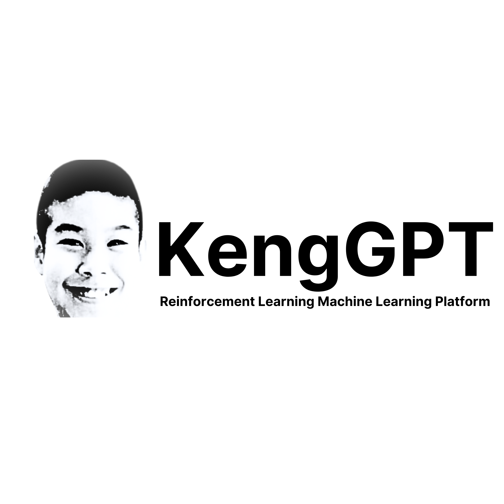

<div align="center">
  
  
  # KengGPT
  
  *An ultra-lightweight, bilingual (Thai/English) RWKV language model built from scratch, engineered to run natively on vintage mobile hardware.*
  
  
  
  
  -purple)
</div>

---

## 🚀 Overview

**KengGPT** is a custom recurrent state-space language model trained from scratch using the **RWKV architecture**. Unlike standard Transformers that struggle with memory scaling on edge devices, KengGPT's recurrent nature allows it to maintain constant memory overhead during inference. 

The primary engineering goal of this project is extreme edge deployment: running a fully functional, conversational bilingual LLM natively on a **Samsung Galaxy S5** (Qualcomm Snapdragon 801 32-bit CPU, 2 GB LPDDR3 RAM) running LineageOS.

---

## 📊 Training & Performance Metrics

KengGPT 1.0 was trained on Google Colab (CUDA) using mixed-precision FP16 and a high-throughput data loader.

| Metric | Epoch 1 / 2 | Epoch 2 / 2 |
| :--- | :--- | :--- |
| **Total Steps** | 1,207 / 1,207 | 1,207 / 1,207 |
| **Time per Epoch** | ~38m 28s (1.91s/it) | ~38m 24s (1.91s/it) |
| **Batch Size** | 256 | 256 |
| **Final Batch Loss** | `3.4230` | `2.9745` |
| **Average Epoch Loss** | `6.6453` | `3.1847` |

*Model checkpoint successfully saved to `/content/kenggpt_rwkv_22m.pth`.*

---

## ⚙️ KengGPT 1.0 ("Kark-0") Baseline Specifications

* **Model Architecture:** ~22 Million parameter RWKV recurrent state space model (`n_embd=384`, `n_layer=8`).
* **Tokenizer:** Custom 4,096-vocabulary Byte-Pair Encoding (BPE) tokenizer (`keng_tokenizer.json`, ~284 KB) designed to fit token lookup tables into <2 MB of RAM.
* **Quantization & Binary:** 4-bit integer quantized weights (`kenggpt_q4_0.bin`, ~13 MB binary footprint).
* **Runtime Engine:** Native C++ JNI bridge (`librwkv.so`) cross-compiled for `armeabi-v7a` with ARM NEON SIMD vectorization.
* **Dataset & Persona:** Fine-tuned on Mr. Keng's bilingual Thai/English Discord chat logs (boosted 10x for personality anchoring) mixed with TinyStories, Thai Wikipedia, SCB MT (EN-TH), and DailyDialog.

---

## 🔭 KengGPT 1.5 ("Solaris") Blueprint

* **Scaled Capacity:** Expanding to 35M–45M parameters (`n_embd=448`, `n_layer=12`) with tied word embeddings to increase reasoning capability without exceeding a strict 25 MB RAM budget.
* **Supervised Fine-Tuning (SFT):** Integration of special control tokens (`<|system|>`, `<|user|>`, `<|assistant|>`) with custom loss masking for robust instruction following and system prompt adherence.
* **Runtime Guardrails:** Finite State Machine (FSM) / Grammar-Constrained Decoding at the C++ sampling layer to eliminate subword fragmentation and out-of-distribution hallucinations.

---

## 📂 Repository Structure

```text
├── keng_gpt_training_1_0_.py   # Complete end-to-end training & inference script
├── keng_tokenizer.json         # Custom 4k BPE tokenizer
├── kenggpt_rwkv_22m.pth        # PyTorch FP16 trained model weights (22M)
└── README.md                   # Project documentation
